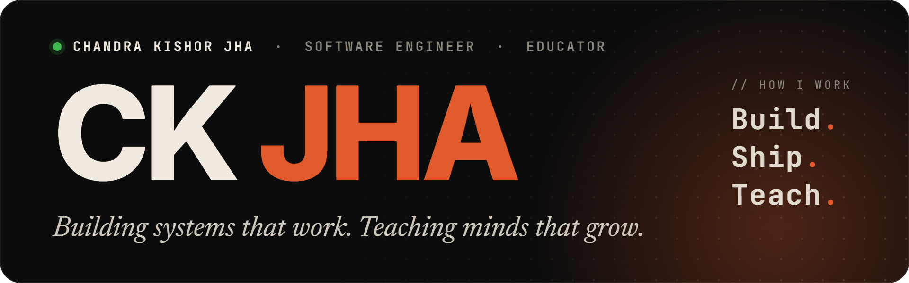
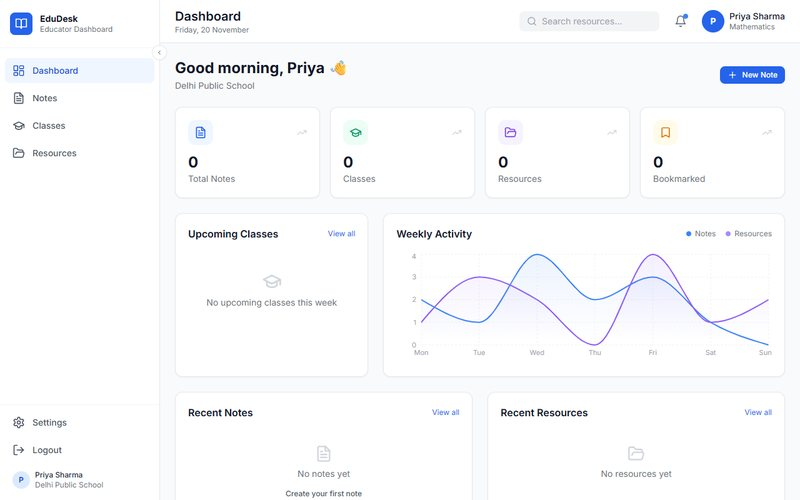
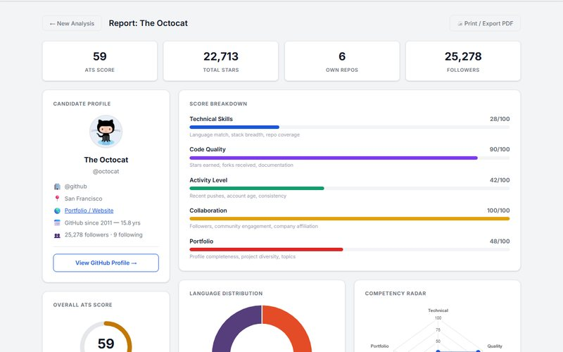
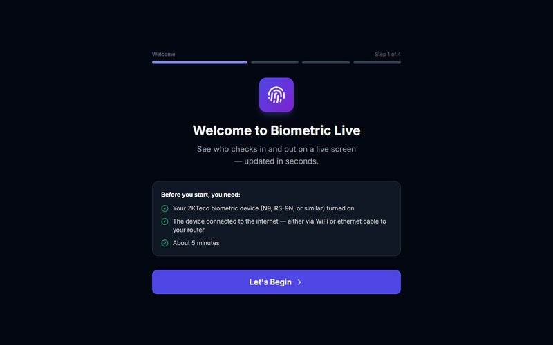
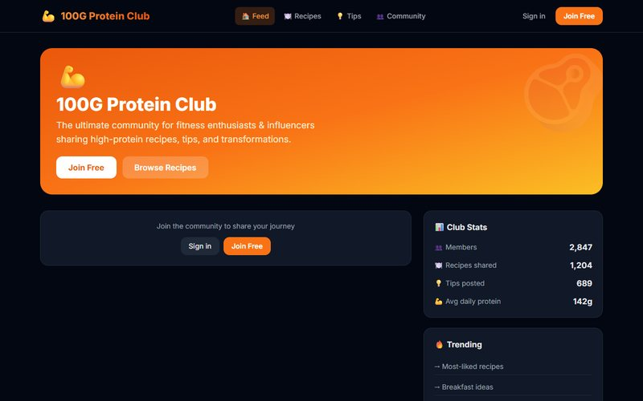
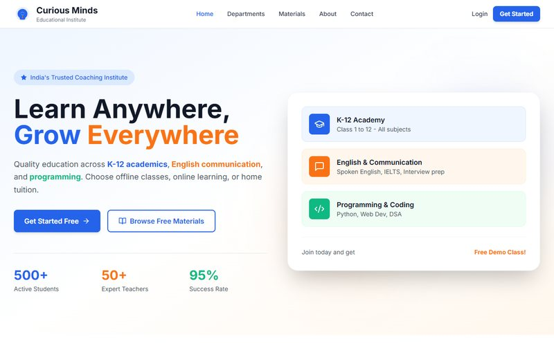
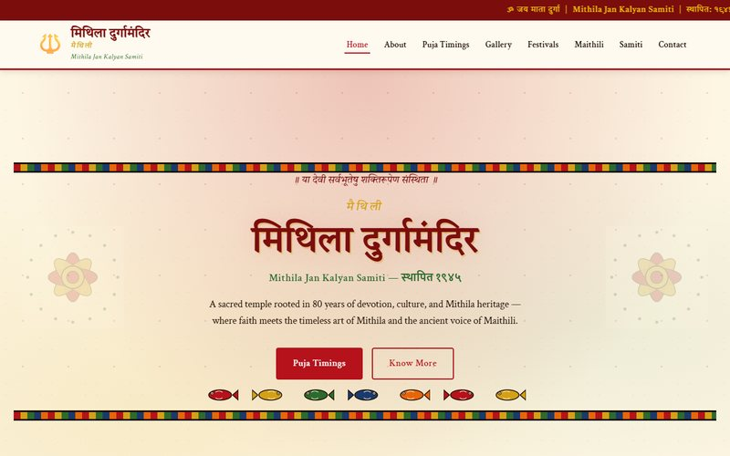

## Hi, I'm CK 👋

I'm a software engineer at **Trade Fabric** in Delhi. I build full-stack web apps with TypeScript, React, Next.js and Node.js, and I've been teaching computer science and maths since 2018, to 300+ students so far.

Most of what I build sits where those two worlds meet: software for teachers, coaching institutes and small businesses that need things to simply work.

**[Portfolio](https://ckworks-xyz.vercel.app)** &nbsp;·&nbsp; [LinkedIn](https://www.linkedin.com/in/chandra-kishor-jha-276744184) &nbsp;·&nbsp; [X](https://x.com/originalckjha) &nbsp;·&nbsp; [Blog](https://thelearnex.blogspot.com) &nbsp;·&nbsp; [ckworkss@gmail.com](mailto:ckworkss@gmail.com)

### Right now

- 🛠️ **Building** production systems at Trade Fabric, where I've been a software engineer since April 2026.
- 🎓 **Teaching** CBSE/ICSE computer science, maths, Python and web development, from Class 6 to college.
- 🤝 **Open to** freelance web projects. [Tell me about yours →](https://docs.google.com/forms/d/e/1FAIpQLSfN6vvvE600Utgi0w2_d_idpaOrTXy1MQdaWYMi22HzvtCvKg/viewform)

## Things I've built

Every project here is live. Click a screenshot to try it.

### EduDesk

A dashboard where CBSE teachers keep their notes, classes and teaching resources in one place, with a weekly activity chart. It has a one-click demo account, so you can look around without signing up.

React · TypeScript · Redux Toolkit · Tailwind CSS · Recharts

**[Live demo](https://cbse-educator-dashboard-mvp.vercel.app)** &nbsp;·&nbsp; [Code](https://github.com/Originalckjha/CBSE-EDUCATOR-DASHBOARD-MVP-)

 

### TalentScore Pro

A candidate scoring tool for hiring teams. It scores IT, warehouse, sales and marketing candidates on five weighted dimensions and gives a clear hiring recommendation. The IT track reads live data from the GitHub API.

JavaScript · Chart.js · GitHub REST API

**[Live demo](https://codearcade-git-hub-account-scorecar.vercel.app)** &nbsp;·&nbsp; [Code](https://github.com/Originalckjha/Codearcade-GitHub.account.scorecard)

 

### Biometric Live

A live attendance board for ZKTeco biometric devices. The device pushes each check-in to the app, which shows who is in and who is out as it happens. A four-step wizard walks you through the setup.

Next.js · TypeScript · Tailwind CSS

**[Live demo](https://biomatricupdate.vercel.app)** &nbsp;·&nbsp; [Code](https://github.com/Originalckjha/Biomatricupdate)

 

### 100G Protein Club

A community app where fitness enthusiasts share high-protein recipes, tips and transformations. The React front end talks to an Express API with JWT sign-in.

React · TypeScript · Tailwind CSS · Express · JWT

**[Live demo](https://100-g-protien-club-frontend.vercel.app)** &nbsp;·&nbsp; [Code](https://github.com/Originalckjha/100G-PROTIEN-CLUB)

 

### Curious Minds

A coaching institute website with three departments, separate logins for students and teachers, and a searchable library of free study material.

React · TypeScript · Vite · Tailwind CSS

**[Live demo](https://curiousminds-eight.vercel.app)** &nbsp;·&nbsp; [Code](https://github.com/Originalckjha/CURIOUSMINDS)

 

### Mithila Durga Mandir

A website for a temple and its community trust, founded in 1945, with puja timings, festivals, a gallery and a Maithili section, decorated with Mithila art motifs. I built it to give back to my community.

TypeScript · Vite · SVG

**[Live site](https://durgamandir-mjks.vercel.app)** &nbsp;·&nbsp; [Code](https://github.com/Originalckjha/DURGAMANDIR-MJKS-)

 

### More work

- **[TradeFabric](https://github.com/Originalckjha/Tradefabric)**: a marketing site for a Delhi fabric supplier, built for search with a sitemap, structured data and Open Graph images. Next.js. ([live](https://tradefabric.vercel.app))
- **[Curiosity Coaching Center](https://github.com/Originalckjha/Curiositycoachingcenter)**: a landing page for a coaching centre in Mangolpuri, Delhi. ([live](https://curiositycoachingcenter.vercel.app))
- **[WeakToStrong](https://github.com/Originalckjha/Weaktostrong)**: my first website, built in 8 hours straight. ([live](https://weaktostrong.vercel.app))
- **[ckworks](https://github.com/Originalckjha/Ckworks.xyz)**: my portfolio, written in plain TypeScript with no framework. ([live](https://ckworks-xyz.vercel.app))

## Tools I use

**Languages**&nbsp;

**Frontend**&nbsp;

**Backend**&nbsp;

**Tools**&nbsp;

## Teaching

I started as a private tutor in 2018, spent three years teaching computer science and maths to Class 10–12 students at a coaching institute, and have mentored college students one-on-one along the way.

**What I teach:** Computer Science (CBSE/ICSE, Class 10–12) · Mathematics (Class 6–12) · Python and DSA basics · Web development · System design for junior developers

## Get in touch

Need a website, a dashboard or an internal tool built? Or a tutor for computer science or maths? Fill in the [project form](https://docs.google.com/forms/d/e/1FAIpQLSfN6vvvE600Utgi0w2_d_idpaOrTXy1MQdaWYMi22HzvtCvKg/viewform), email [ckworkss@gmail.com](mailto:ckworkss@gmail.com), or message me on [LinkedIn](https://www.linkedin.com/in/chandra-kishor-jha-276744184).

<i>Dharma · Tapasya · Satya · Jigyasa</i> Purpose over hype. Deep focus. Honest code. Lifelong learning.

